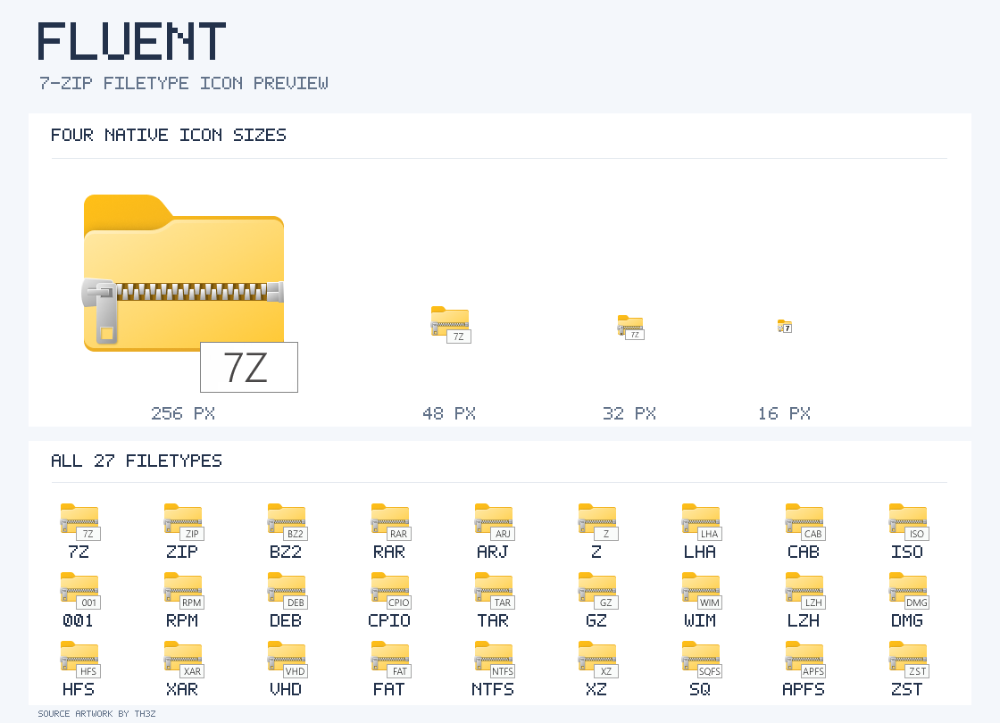
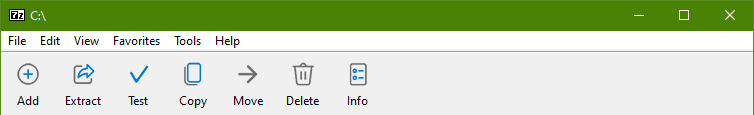

# 7-Zip Filetype Theme

Custom filetype icons and File Manager toolbar artwork for **official 7-Zip on Windows**. This is a maintained fork of [Mr4Mike4/7-Zip-Filetype-Theme](https://github.com/Mr4Mike4/7-Zip-Filetype-Theme).

[**Download the latest release**](https://github.com/mwyau/7-Zip-Filetype-Theme/releases/latest) · [Official 7-Zip](https://www.7-zip.org/)

## Previews

**Fluent filetype icons** — the 7-Zip icon at four native sizes, followed by all 27 filetype icons:

**Windows 11 Ribbon toolbar:**

## Which file should I download?

Choose a theme for your installed 7-Zip architecture: `x64` for 64-bit or `x86` for 32-bit. Packages are not interchangeable.

| Theme | 64-bit 7-Zip | 32-bit 7-Zip | Changes |
|---|---|---|---|
| Windows 10 | [`windows10-x64.7z`](https://github.com/mwyau/7-Zip-Filetype-Theme/releases/latest/download/windows10-x64.7z) | [`windows10-x86.7z`](https://github.com/mwyau/7-Zip-Filetype-Theme/releases/latest/download/windows10-x86.7z) | Filetype icons (`7z.dll`) |
| Fluent | [`fluent-x64.7z`](https://github.com/mwyau/7-Zip-Filetype-Theme/releases/latest/download/fluent-x64.7z) | [`fluent-x86.7z`](https://github.com/mwyau/7-Zip-Filetype-Theme/releases/latest/download/fluent-x86.7z) | Filetype icons (`7z.dll`) |
| Fluent Blue | [`fluent-blue-x64.7z`](https://github.com/mwyau/7-Zip-Filetype-Theme/releases/latest/download/fluent-blue-x64.7z) | [`fluent-blue-x86.7z`](https://github.com/mwyau/7-Zip-Filetype-Theme/releases/latest/download/fluent-blue-x86.7z) | Filetype icons (`7z.dll`) |
| Windows 11 Ribbon | [`windows11-ribbon-x64.7z`](https://github.com/mwyau/7-Zip-Filetype-Theme/releases/latest/download/windows11-ribbon-x64.7z) | [`windows11-ribbon-x86.7z`](https://github.com/mwyau/7-Zip-Filetype-Theme/releases/latest/download/windows11-ribbon-x86.7z) | File Manager toolbar (`7zFM.exe`) |

Install **one** filetype theme; the Windows 11 Ribbon package is optional and can be combined with any filetype theme of the same architecture and 7-Zip version. These are **theme patches, not complete 7-Zip installers**. Windows ARM64 is not supported.

## Installation

1. Install [official 7-Zip](https://www.7-zip.org/) and verify that its **version exactly matches** the version named in the theme release (for example, 7-Zip 26.04). Check the installed architecture too.
2. Download the appropriate `.7z` theme package from the [latest release](https://github.com/mwyau/7-Zip-Filetype-Theme/releases/latest) and extract it to a temporary directory.
3. Close 7-Zip File Manager and other running 7-Zip processes.
4. Open the 7-Zip installation directory (typically `C:\Program Files\7-Zip\` for x64 or `C:\Program Files (x86)\7-Zip\` for x86). **Back up the original `7z.dll` and/or `7zFM.exe`** before replacing anything.
5. Copy the extracted `7z.dll` (filetype theme) and/or `7zFM.exe` (Ribbon theme) to that directory. Administrator permission may be required. Do not replace unrelated files.
6. Reopen 7-Zip. If Explorer icons have not changed, restart Windows Explorer or sign out and back in. The icons shown by Explorer also depend on the current file associations.

**Restore:** Copy back the original files you backed up, or reinstall the matching official 7-Zip version. A later 7-Zip installation or upgrade may overwrite these patches; never use a patch built for a different version.

## Verification and credits

The packages contain modified copies of official 7-Zip binaries (`7z.dll` and `7zFM.exe`), which may invalidate their Authenticode signatures. CI checks resource integrity, runs functional tests, and scans binaries and archives with ClamAV. Release [checksums and build records](https://github.com/mwyau/7-Zip-Filetype-Theme/releases/latest) are available for verification.

Windows 10 icons: [masamunecyrus](https://www.deviantart.com/masamunecyrus). Fluent and Fluent Blue icons: [Th3Z](https://www.deviantart.com/th3z). Original theme project: [Mr4Mike4](https://github.com/Mr4Mike4/7-Zip-Filetype-Theme). Redistribution permission for the third-party artwork has not been independently verified. See [artwork attribution and rights](docs/artwork-rights.md).

For development, testing, automation, and release maintenance, see [AGENTS.md](AGENTS.md).
